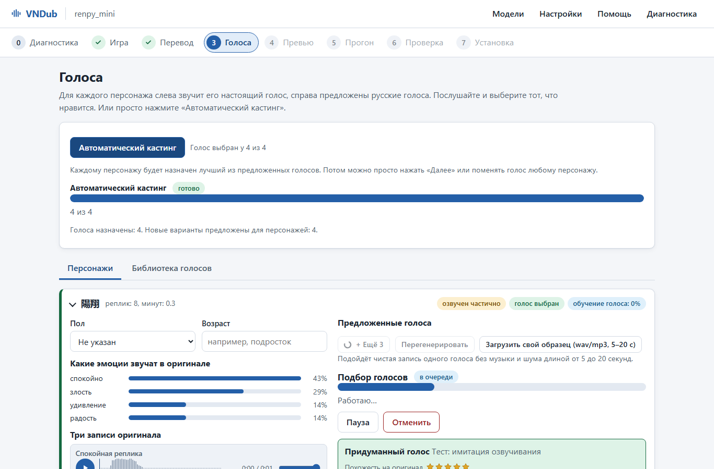
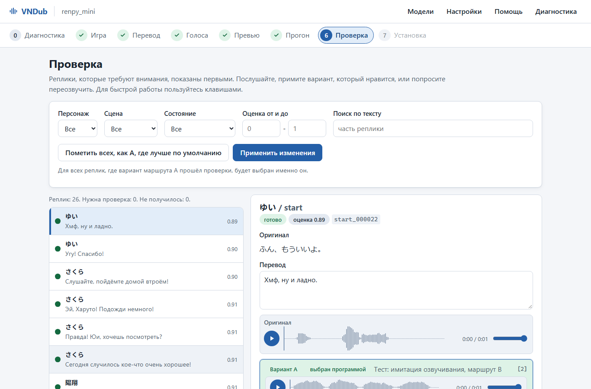

# VN-dub

## Contributors

<a href="https://github.com/TheLostDesu/VN-dub/graphs/contributors">
  
</a>

| | Contributor | Contribution |
|---|---|---|
|  | [**TheLostDesu**](https://github.com/TheLostDesu) | idea, research lead, architecture, AI-agent direction * |
|  | [**AZLik**](https://github.com/AZLik) | lead tester: real GPU, real games |

<i>* The code and the tests were written by AI coding agents (Claude Code) under that direction.</i>

## What this is

Fully local AI dubbing for visual novels: game assets -> who says which line with which voice file -> a measured
"expression passport" of every original line -> translation -> expressive speech in the target language (Russian by
default) in the same character's voice -> automatic scoring and selection -> a patch in the game's own format.

Design target: Windows 11, one NVIDIA GPU with 8 GB of VRAM, offline at run time, long preprocessing allowed. Only one
heavy model sits in VRAM at a time; every model family runs in its own virtual environment behind a JSON-RPC adapter.

> ## About this project
>
> This repository is how I learned agentic coding. I did not write the code by hand: I set the goal, ran the research
> (engines and their script formats, local TTS and voice conversion models that fit 8 GB, speech metrics), made the
> product and architecture decisions, wrote the specifications, directed AI coding agents (Claude Code) round after
> round, and decided what was good enough to ship. The agents wrote the code and the tests.
>
> Every release was then run by a human tester on a real GPU machine, on real games, and judged by ear: most of the
> fixes in [CHANGELOG.md](CHANGELOG.md) come from those reports. Treat it as a working experiment, not a polished
> product.

## What it does

- **Imports a game**: Ren'Py first (scripts, `.rpa` archives, dialogue identifiers as Ren'Py computes them), with
  experimental support for KiriKiri, BGI, NScripter, Tyrano, Artemis, Siglus, CatSystem2 and Unity.
- **Translates** with a local LLM through llama.cpp: glossary, character sheet, the player's gender, consistency
  checks, and a second pass for lines that fail them.
- **Casts voices**: cloning or converting the original voice when the game has one, designed voices when it never had
  voice acting.
- **Synthesizes several takes per line** with interchangeable TTS backends (Qwen3-TTS, CosyVoice 3, Chatterbox,
  VoxCPM2 and others), measures them (intelligibility, speaker similarity, naturalness) and keeps the best one.
- **Builds a patch**: voice files, the translated text on screen, a voice volume panel in the game, with a backup and
  one-click undo.

## Desktop app

`VNDub` is a desktop application over the same pipeline for people who never open a terminal (Russian interface by
default, English second): a wizard from diagnostics and the game folder through translation, voice casting, a quick
preview, the full run and review to installing the patch into the game, plus an in-app installer for tools, backend
environments and models. User manual (in Russian): [docs/APP.md](docs/APP.md).

<p align="center">
  
  
</p>

## Quick start

```bash
uv sync
uv run vndub --help
uv run vndub run --config configs/pipeline.test.yaml --project tests/fixtures/renpy_mini   # mock profile, no GPU needed
```

```bash
uv run vndub-app                                           # window (pywebview); --browser for a browser tab
cd vndub_app/web && npm ci && npm run build && cd ../..   # only after editing the SPA (Node.js 20+); the build is in the repo
VNDUB_APP_PROFILE=apptest uv run vndub-app                 # all-mock profile: interface work without models
powershell -File packaging/build_app.ps1                   # dist/VNDub/VNDub.exe (+ installer when Inno Setup 6 is installed)
```

## Documentation

| Doc | Contents |
|---|---|
| [docs/README.md](docs/README.md) | Quickstart: install, backend environments, model download, first run, review |
| [docs/PIPELINE.md](docs/PIPELINE.md) | Stages, inputs and outputs, data contracts, config keys |
| [docs/ENGINES.md](docs/ENGINES.md) | Per-engine extraction, parsing and packing, external tools |
| [docs/MODELS.md](docs/MODELS.md) | Every model: id, role, VRAM, license, fallback |
| [docs/TROUBLESHOOTING.md](docs/TROUBLESHOOTING.md) | Common failures and fixes |
| [docs/APP.md](docs/APP.md) | Desktop app user manual (Russian, with screenshots) |
| [vndub_app/API.md](vndub_app/API.md) | Desktop app internals: REST and WebSocket API, jobs, i18n |
| [CHANGELOG.md](CHANGELOG.md) | What every release changed |

## Status and limits

- Verified by an automated test suite on mock models and by manual runs on one 8 GB GPU machine; the build machine has
  no NVIDIA GPU. Expect rough edges.
- Dubbing quality depends on the models that fit 8 GB: translation by a 9B model, voices by the TTS backends listed in
  [docs/MODELS.md](docs/MODELS.md). Review of the result by a human is part of the workflow, not an option.

## Legal note

vndub processes copyrighted game assets (scripts and voice recordings) that you own, for your private or research use.
It ships no game data: the only audio in this repository is synthetic test fixtures generated by
`scripts/make_fixtures.py`. Voice cloning of real voice actors may be restricted by law, by the game's EULA and by model
licenses (several optional backends are non-commercial; see `license_policy` and docs/MODELS.md). Do not distribute
generated patches or voices without the necessary rights.
