# VNDub — руководство пользователя

VNDub озвучивает визуальные новеллы (японские, английские и другие: язык текста определяется сам) на русском языке прямо на вашем компьютере: без интернета
(после установки моделей), без облачных сервисов и без командной строки. Программа сама разбирает игру,
переводит реплики, подбирает каждому персонажу русский голос, озвучивает все реплики с той же интонацией,
что в оригинале, и устанавливает получившийся патч в игру.

Скриншоты в этом руководстве сделаны автоматическим тестом на маленькой демонстрационной игре.

## Что нужно

- Windows 10 или 11.
- Видеокарта NVIDIA с 8 ГБ видеопамяти (например, RTX 3060/4060 8 ГБ). Без неё программа запустится и
  покажет, чего не хватает, но озвучивать игры не сможет.
- Свободное место на диске: модели занимают десятки гигабайт (точный размер видно в разделе «Модели»),
  плюс место под проект игры.
- Интернет нужен только один раз — чтобы скачать модели и инструменты. Потом всё работает офлайн.
- Git и Microsoft Visual C++ ставить самому не нужно: установщик VNDub берёт их с собой (см. «Что ещё ставит установщик»).
- Сама игра, установленная на компьютере. VNDub ничего не скачивает и не распространяет: он работает
  только с файлами вашей игры.

## Установка и удаление

1. Запустите `VNDub-Setup.exe` (около 150 МБ). Права администратора для самой программы не нужны (Windows может спросить их только для среды выполнения Microsoft Visual C++, см. ниже): программа ставится только
   для вас, в `%LOCALAPPDATA%\Programs\VNDub`. Установщик не подписан цифровой подписью, поэтому Windows
   SmartScreen может написать «Windows защитила ваш компьютер»: нажмите «Подробнее», затем «Выполнить в
   любом случае».
2. Шаги установщика: папка установки (обычно подходит предложенная), «Дополнительные задачи» (значок на
   рабочем столе — по желанию), «Установить», «Завершить». Язык установщика — русский или английский, по
   языку Windows.
3. Запустите VNDub из меню «Пуск» (ярлык «VNDub») или с рабочего стола, если отметили значок. Откроется окно
   программы — консоли не будет.
4. Новую версию ставьте поверх старой, тем же `VNDub-Setup.exe`: программа заменится, данные не тронутся.
   Если VNDub в это время запущен, установщик сам закроет его.

### Что ещё ставит установщик

Моделям на чистой Windows нужны две вещи, которых в системе может не быть, а играм на BGI — утилита, которую негде скачать готовой. Установщик берёт всё это с собой, скачивать отдельно ничего не нужно:

- **Microsoft Visual C++ 2015-2022 (x64)** — «среда выполнения», без которой не запускается ни одна модель: ни перевод, ни озвучка, ни распознавание речи. Установщик смотрит в реестр Windows: если среда уже есть (версия 14.40 или новее), он её не трогает. Если её нет или она старая, он запускает файл `redist\vc_redist.x64.exe`, подписанный Microsoft. **Windows покажет свой запрос «Разрешить этому приложению вносить изменения?» от Microsoft Corporation** — это единственный запрос прав администратора: среда выполнения ставится на весь компьютер (сам VNDub по-прежнему ставится без администратора). Пока она ставится, в окне установщика написано «Установка Microsoft Visual C++…». Если отказаться от запроса или установка не удалась, VNDub всё равно установится: в «Диагностике» будет красная строка с кнопкой «Установить Visual C++» (файл остаётся в папке `redist`, чтобы можно было повторить). При удалении VNDub среда выполнения Windows не удаляется: ею пользуются и другие программы.
- **Git** — нужен, чтобы при установке окружений скачать исходники некоторых нейросетей (RVC, Seed-VC, VoxCPM, CosyVoice, UTMOSv2). В комплекте идёт портативный MinGit в папке `git` рядом с `VNDub.exe` (лицензия GPL-2.0, текст в `git\LICENSE.txt`). Если Git уже установлен у вас, VNDub использует его, иначе свой. В системе ничего не меняется: Git не попадает в PATH, программа подставляет его только себе, когда ставит окружения.
- **bgi-extractor** — достаёт текст, имена персонажей и номера реплик озвучки из архивов игр на движке BGI (Ethornell). Его автор выкладывает только исходники, поэтому VNDub собирает его сам и кладёт в папку `bin\bgi-extractor` рядом с `VNDub.exe` (лицензия MIT, текст в `LICENSE.txt` там же). Скачивать его вручную больше не нужно: на экране «Модели и утилиты» он сразу отмечен как установленный. Если положить свою сборку в папку утилит программы, будет использоваться она.

Все данные (модели, окружения нейросетей вместе с их Python и кешем загрузок, проекты, резервные копии файлов игр, журналы) хранятся отдельно от
программы — в папке данных, по умолчанию `%LOCALAPPDATA%\VNDub`. Её можно поменять в «Настройках», например
перенести на диск побольше; выбранное место запоминается в `%APPDATA%\VNDub\location.json`.

| Что | Где |
|---|---|
| Программа | `%LOCALAPPDATA%\Programs\VNDub` (`VNDub.exe`, папки `_internal`, `git` и `redist`, `unins000.exe`) |
| Ярлыки | меню «Пуск» → «VNDub»; значок на рабочем столе, если отметили |
| Запись об удалении | «Параметры» → «Приложения» (в Windows 10 — «Приложения и возможности») → VNDub |
| Данные | папка данных (по умолчанию `%LOCALAPPDATA%\VNDub`) |

### Удаление и вопрос про данные

Удаляйте программу через «Параметры» → «Приложения» → VNDub → «Удалить» (или запустите `unins000.exe` из папки
программы). Запущенный VNDub деинсталлятор закроет сам. После обычного подтверждения он спросит, что сделать с
папкой данных, и покажет её путь:

- **«Оставить данные»** — выбрано по умолчанию (достаточно нажать Enter). Удаляется только программа; модели,
  проекты и резервные копии остаются, и после новой установки всё снова на месте — модели не придётся
  скачивать заново.
- **«Удалить данные»** — безвозвратно стираются модели, окружения, проекты, резервные копии оригинальных
  файлов игр (они нужны, чтобы откатить патч) и журналы. Игры, в которые патч уже установлен, остаются
  как есть: вернуть оригинал без резервных копий можно только проверкой файлов игры или её переустановкой.

Стирается только то, что создал сам VNDub: если вы указали папку данных, где лежат и ваши файлы, они
останутся. Модели вне папки данных не удаляются. Если вы меняли папку данных в «Настройках», прежняя папка
(старые модели и проекты) не удаляется: это делается вручную.

Для скриптов есть тихая установка и удаление, без окон и вопросов:

```
VNDub-Setup.exe /VERYSILENT /SUPPRESSMSGBOXES /NORESTART [/DIR="D:\Apps\VNDub"] [/LANG=english]
"%LOCALAPPDATA%\Programs\VNDub\unins000.exe" /VERYSILENT /SUPPRESSMSGBOXES /NORESTART [/DELETEDATA=1]
```

Тихое удаление всегда оставляет данные, если не указать `/DELETEDATA=1` (тогда папка данных стирается без
вопроса; этот ключ работает и в обычном режиме). Если задана переменная среды `VNDUB_DATA`, и программа, и
деинсталлятор считают папкой данных её значение.

Тихая установка тоже спросит разрешение Windows, если среды выполнения Visual C++ на компьютере нет: запрос показывает программа Microsoft, его нельзя подавить. Что решил установщик, видно в журнале (`VNDub-Setup.exe /LOG="C:\путь\setup.log"`): строки «VC++ runtime ...» говорят, есть ли среда, запускался ли `vc_redist.x64.exe` и с каким кодом он завершился (0, 1638 и 3010 — успех).

## Как устроена программа

Вверху окна — название открытой игры и кнопки «Модели», «Настройки», «Помощь», «Диагностика». Под ними —
шаги мастера: от «Диагностики» до «Установки». Шаги можно проходить по порядку кнопкой «Далее», а можно
вернуться к любому пройденному.

Долгие операции (разбор игры, озвучка) идут в фоне: видно, что делается сейчас, сколько реплик готово,
сколько осталось ждать. Их можно приостановить и отменить. Если закрыть программу посреди работы, при
следующем запуске она предложит **«Продолжить с того места, где остановились»** — уже сделанное не
пересчитывается.

Если что-то пошло не так, программа пишет одной фразой, что случилось, и что сделать (обычно это кнопка).
Технические подробности спрятаны под «Показать подробности» — их стоит приложить к отчёту о проблеме.

## Шаг 0. Диагностика

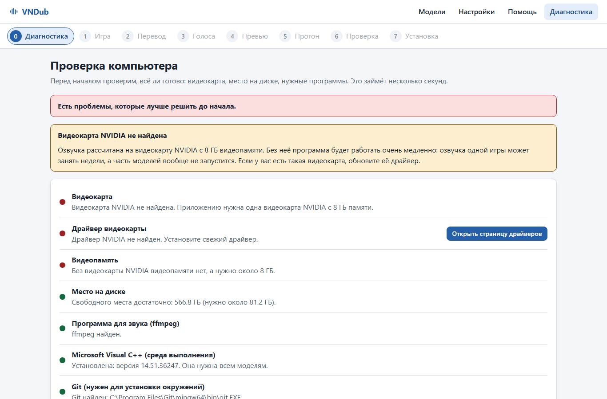

Программа проверяет компьютер и показывает строки зелёного, жёлтого или красного цвета:

- **Видеокарта и видеопамять** — нужна одна видеокарта NVIDIA с 8 ГБ. Если её нет, программа так и
  скажет простыми словами (на скриншоте — ноутбук без NVIDIA).
- **Драйвер NVIDIA** — если он устарел, кнопка откроет страницу загрузки драйвера.
- **Место на диске** — хватит ли места под модели и проект.
- **ffmpeg** — программа для работы со звуком; если её нет, кнопка «Скачать ffmpeg» поставит её сама.
- **Microsoft Visual C++ (среда выполнения)** — без неё не запускаются модели. Зелёная строка показывает версию. Красная значит, что среды нет или она слишком старая: кнопка «Установить Visual C++» запускает файл из папки `redist` (Windows спросит разрешение администратора, как при установке). Если программу запустили из исходников, кнопка «Скачать с сайта Microsoft» открывает страницу загрузки. Строка есть только в Windows.
- **Git** — нужен для установки части окружений. Зелёная строка говорит, откуда он взят: ваш системный или из комплекта VNDub. Жёлтая — Git не найден; в строке перечислены окружения, которым он нужен (установите Git с git-scm.com или переустановите VNDub).
- **Интернет** — нужен только для загрузок.
- **Антивирус** — совет добавить папку данных в исключения Защитника Windows (это ускоряет работу).
  Программа показывает точную команду и путь в настройках, но сама настройки безопасности не меняет.
- **Окружения и модели** — установлены ли нейросети. Если нет — кнопка ведёт в раздел «Модели».

## Шаг 1. Игра

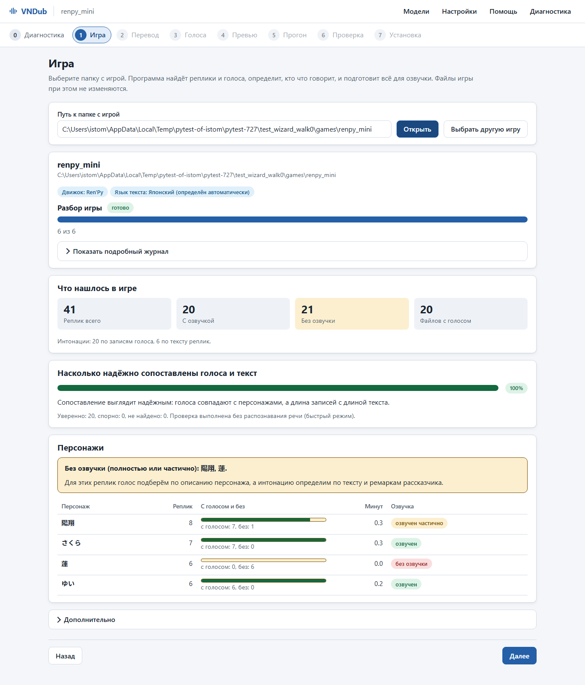

Нажмите **«Выбрать папку игры»** и укажите папку, где лежит игра (там, где её `.exe`). Программа сама
определит движок (Ren'Py, KiriKiri, NScripter, Siglus, BGI и другие), найдёт файлы озвучки и сценарий,
разберёт, кто какую реплику говорит, и прослушает интонацию каждой реплики.

Игровая папка на этом шаге только читается — в ней ничего не меняется до шага 7.

После разбора вы увидите:

- сколько всего реплик и сколько из них озвучено;
- список персонажей: сколько у каждого реплик и минут озвучки. Персонажи **без озвучки** (часто это
  главный герой) видны сразу — их тоже можно озвучить, голос подбирается по описанию;
- **насколько надёжно** реплики сопоставлены с файлами озвучки. Если программа сомневается, она предложит
  «Проверить сопоставление распознаванием речи, медленно» — это необязательно;
- **«Проблемные файлы»** — повреждённые или подозрительные файлы (список можно не открывать, работе он не
  мешает).

Особые случаи:

- **Зашифрованная игра.** Если движку нужен дополнительный инструмент, программа предложит
  «Скачать и установить». Для зашифрованных игр на KiriKiri Z есть пошаговая инструкция с картинками
  (KrkrDump).
- **В игре нет озвучки вообще.** Программа так и напишет: «голоса будут подобраны по описанию
  персонажей, интонация — по тексту». Интонацию она берёт из знаков препинания и из ремарок вокруг
  реплики («прошептала», «сквозь слёзы»). Если в тексте нет никаких подсказок, реплика звучит спокойно —
  программа не придумывает драму.
- **Есть озвучка, но нет текста** (сценарий не удалось прочитать). Тогда появится кнопка
  «Распознать текст из озвучки» — только в этом случае программа распознаёт японскую речь. Такие реплики
  потом помечены на шаге «Проверка», и их текст можно поправить.
- **Игра разобрана прошлой версией программы.** Если с тех пор изменился способ, которым программа находит
  реплики (например, идентификаторы реплик Ren'Py считаются как в самом Ren'Py), под описанием игры
  появится жёлтая плашка **«Игра разобрана прошлой версией программы»** с кнопкой «Разобрать игру заново»;
  такая же плашка есть на шаге 5. Переводы и готовая озвучка при этом не пропадают: после нового разбора
  запустите полную озвучку ещё раз, и всё, что не изменилось, возьмётся из готового, а патч соберётся заново.

## Шаг 2. Перевод и настройки

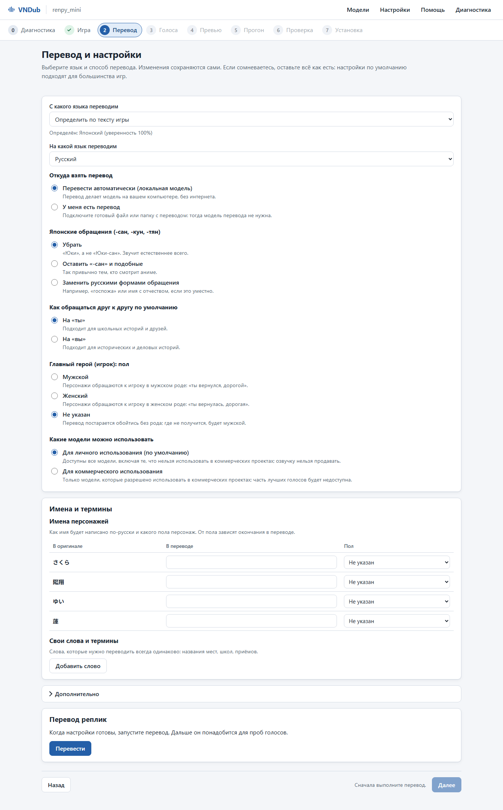

- **С какого языка переводим** — по умолчанию программа сама определяет язык текста игры при импорте
  (японский, английский, китайский, корейский, русский и другие) и показывает его здесь и на шаге 1
  («Язык текста»). Если определила неверно, выберите язык вручную. Текст, который уже на языке озвучки,
  остаётся как есть, модель перевода не запускается.
- **Язык озвучки** — русский (можно выбрать английский).
- **Откуда взять перевод:** «Перевести автоматически (локальная модель)» или «У меня есть перевод» —
  тогда укажите файл или папку с переводом, и программа покажет первые пять сопоставленных строк.
- **Японские именные суффиксы** (-сан, -тян): убрать, оставить или передать по-русски.
- **Обращение по умолчанию**: «ты» или «вы».
- **Главный герой (игрок): пол** — мужской, женский или не указан. От него зависят окончания в репликах,
  обращённых к игроку («ты вернулся, дорогой» / «ты вернулась, дорогая»); если пол не указан, модель
  избегает окончаний, а где это невозможно, берёт мужской род.
- **Лицензии моделей**: «для себя / исследований» разрешает все модели; «коммерческое использование»
  оставляет только модели, которые это разрешают.
- **Глоссарий**: как пишутся имена персонажей по-русски и их пол (от пола зависят окончания глаголов),
  плюс любые термины игры.
- В разделе «Дополнительно» — число вариантов на реплику, способы озвучки, выбор моделей и таблица
  ремарок, по которым программа понимает интонацию без озвучки.

Нажмите **«Перевести»**: перевод идёт в фоне, после него можно идти дальше.

## Шаг 3. Голоса (кастинг)

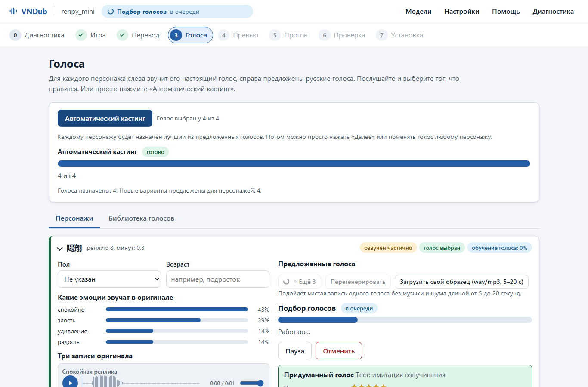

Самый важный шаг. Для каждого персонажа (сначала самые разговорчивые):

- **слева** — его настоящий голос: три записи из игры (спокойная, самая эмоциональная, самая длинная),
  какие эмоции звучат в оригинале, пол и возраст (можно поправить);
- **справа** — предложенные русские голоса. Каждый можно прослушать на двух репликах этого персонажа,
  уже переведённых на русский. Звёзды «похожесть на оригинал» показывают, насколько голос близок к
  оригиналу.

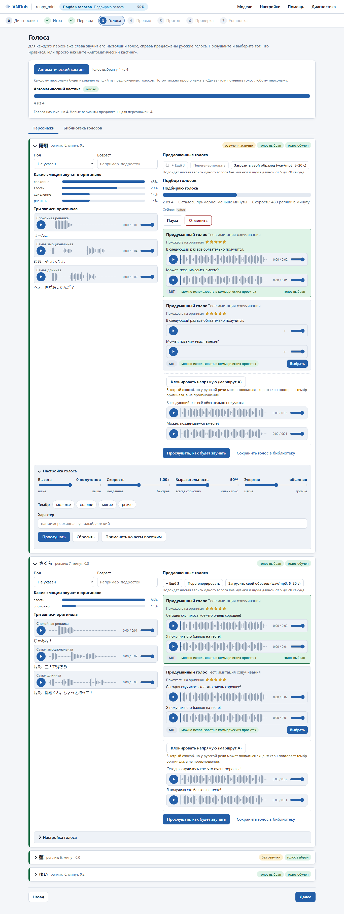

Что можно сделать:

- **«Выбрать»** — назначить голос персонажу;
- **«+ Ещё 3»** и **«Перегенерировать»** — получить другие варианты;
- **«Загрузить свой образец»** — свой файл wav/mp3 длиной 5–20 секунд с чистым голосом без музыки;
- **«Клонировать напрямую»** — повторить тембр оригинала напрямую. Быстро, но в русской речи может
  появиться акцент;
- **«Прослушать, как будет звучать»** — три реплики персонажа: оригинал и результат рядом;
- **«Автоматический кастинг»** — программа сама подберёт лучший голос всем персонажам, после этого можно
  просто нажать «Далее».

Реплики, которые в игре озвучены, но идут без имени в окне (голос за кадром, «？？？»), программа
отдаёт тому персонажу, чей это голос, если это видно по имени звукового файла (`sak_0012.ogg` — Сакура).
Если по файлу не понять, чей голос, такие реплики собираются в отдельную карточку **«Голос за кадром»**
с пометкой «Без имени в игре»: ей выбирают голос, как обычному персонажу. Неозвученный текст рассказчика
не озвучивается.

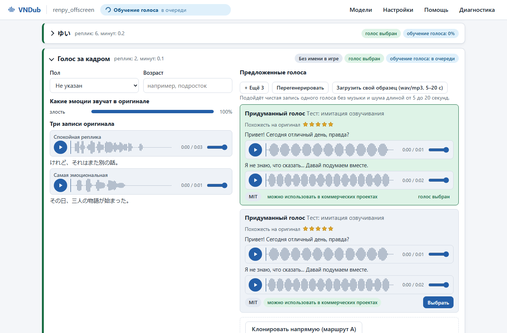

У персонажей без озвучки нет записей и звёзд: вместо этого опишите голос словами («строгая учительница,
низкий голос»), и программа предложит подходящие голоса. Во вкладке **«Библиотека голосов»** хранятся
голоса из прошлых проектов — понравившийся голос можно взять снова.

### Настройка голоса

Под выбранным голосом есть простая панель:

- **Высота** — от −6 до +6 полутонов;
- **Скорость** — от 0,8 до 1,2;
- **Выразительность** — 0 значит «всегда спокойно», 1 — «ярче, чем в оригинале»;
- **Энергия** — мягче или громче;
- **Тембр** — моложе, старше, мягче, резче;
- **Характер** — пара слов своими словами: «ехидная», «усталый», «детский».

«Прослушать» за несколько секунд озвучит одну спокойную и одну эмоциональную реплику с этими
настройками. «Сбросить» возвращает всё как было, «Применить ко всем похожим» копирует настройки
персонажам того же пола и возраста. Меняется только этот персонаж — остальные реплики не пересчитываются.

## Шаг 4. Быстрое превью

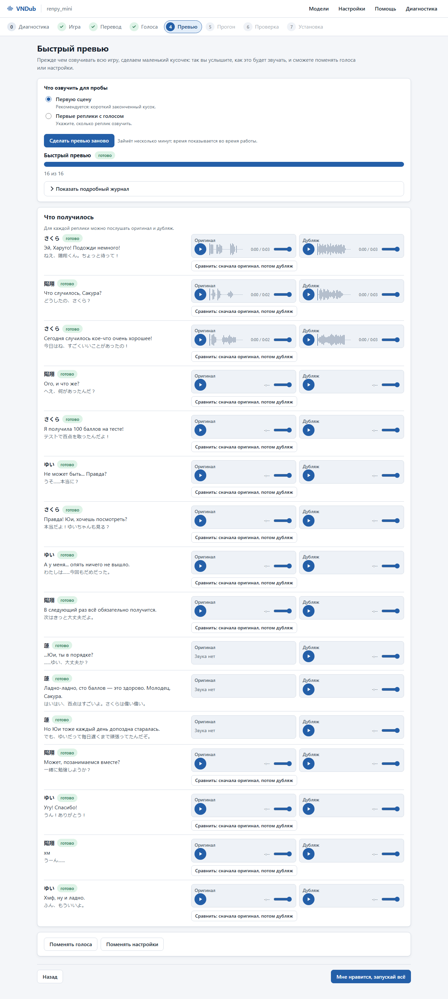

Прежде чем озвучивать всю игру, программа озвучит первую сцену (или первые 40 реплик) и покажет список:
оригинал и русская озвучка рядом, с текстом. Если нравится — **«Мне нравится, запускай всё»**. Если нет —
«Поменять голоса» (назад к кастингу) или «Поменять настройки».

## Шаг 5. Полная озвучка

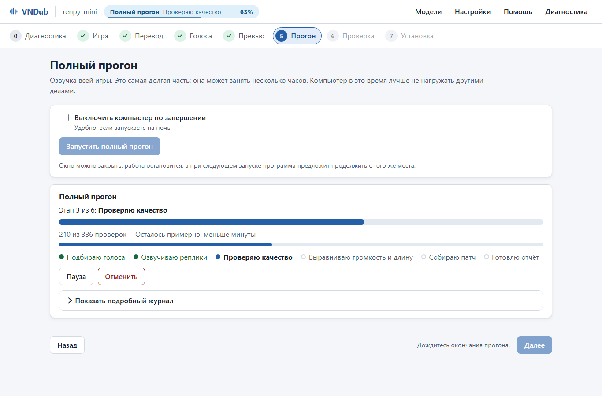

Здесь видно, какой этап идёт, сколько реплик готово, скорость и сколько осталось ждать, а также загрузка
видеопамяти. Работу можно приостановить, продолжить или отменить. Можно поставить галочку
«Выключить компьютер по завершении».

Озвучка большой игры может идти много часов — программу можно закрыть, а потом продолжить.

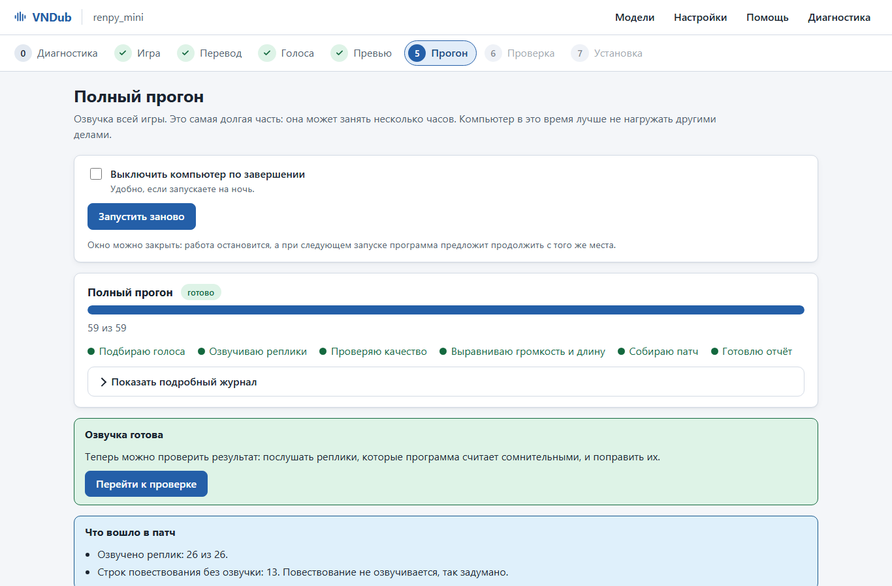

Под сообщением «Озвучка готова» программа пишет, **что вошло в патч**:

- «Озвучено реплик: N из M»;
- «Предварительно озвучено реплик» — реплики, у которых ни один дубль не прошёл проверки качества. Раньше
  такие реплики в патч не попадали и в игре молчали; теперь в патч кладётся лучший дубль и реплика
  помечается как предварительная. Их стоит послушать на шаге «Проверка» (рядом кнопка «К проверке»);
- «Не попало в патч реплик» — реплики без звукового файла, с причинами (например, «озвучить не удалось»).
  В игре они останутся без озвучки. Строка есть, только если такие реплики есть;
- «Строк повествования без озвучки» — строки без говорящего, их программа не озвучивает.

Плашка жёлтая, если есть предварительные или пропущенные реплики. Те же числа видны на шаге 7 рядом со списком
файлов патча и в `INSTALL.md`.

## Шаг 6. Проверка

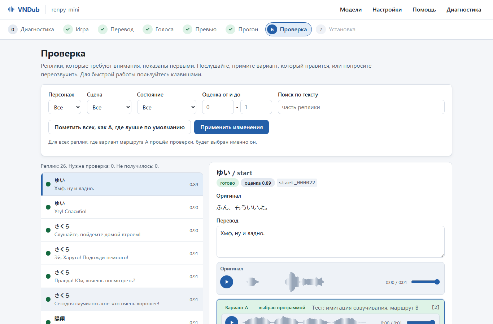

Программа сама выбирает лучший вариант каждой реплики, а сомнительные ставит в начало списка с пометкой
«нужна проверка». Для каждой реплики видно:

- оригинал и до трёх русских вариантов;
- короткие оценки вместо цифр: «голос: похож», «эмоция: близко», «разборчивость: хорошо»,
  «длина: длинновато» (цифры — во всплывающей подсказке);
- **«Почему здесь»** — простыми словами, что не понравилось программе;
- для реплик без озвучки — откуда взята интонация («по тексту: LLM / по ремарке / нейтрально»), её можно
  поправить.

Реплика с пометкой «нужна проверка» **не пропала из игры**: её лучший дубль уже лежит в патче, и в списке у неё
стоит метка «предварительная» (в подробностях: «в патче как предварительная»). Метка «нет в патче» означает, что у
реплики вообще нет звукового файла и в игре она будет без озвучки. После «Применить изменения» метки
обновляются: принятый вариант перестаёт быть предварительным.

Действия: принять, отклонить, перегенерировать (можно исправить текст и описание интонации), выбрать
другой образец голоса, оставить оригинал, настроить голос «только для этой реплики». Если вы исправили
текст так, что в нём появился смех («Ха-ха!») или он перестал быть смехом, пометки реплики
(«смех», «междометие») меняются вместе с текстом: от них зависят строгость проверки и число пробных дублей.

Клавиши: **Пробел** — играть/пауза, **1/2/3** — оригинал/вариант A/вариант B, **Enter** — принять,
**R** — перегенерировать, **стрелки** — предыдущая/следующая реплика.

После правок нажмите **«Применить изменения»** — программа переозвучит только затронутые реплики и
покажет, сколько файлов изменилось.

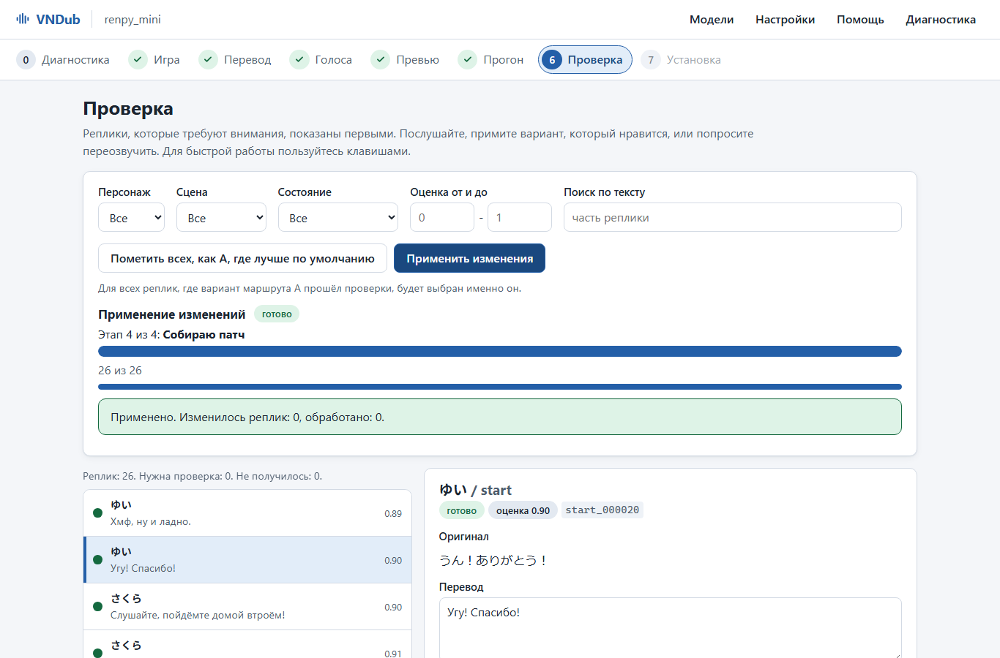

## Шаг 7. Установка патча

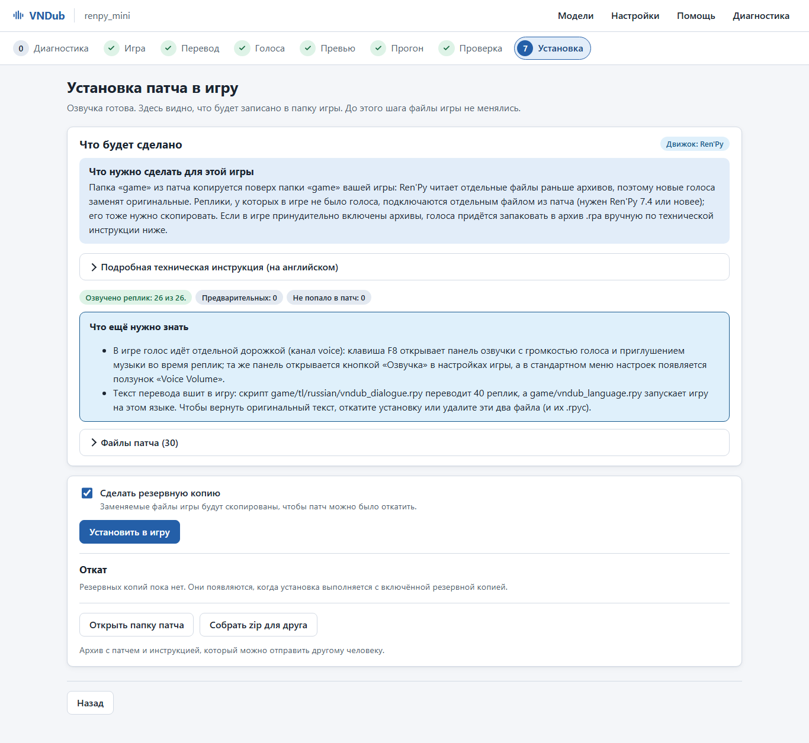

Программа показывает, что и куда будет записано, и объясняет порядок установки для движка вашей игры.

- **«Сделать резервную копию»** (включено по умолчанию) — заменяемые файлы игры сохраняются в папку
  данных (`backups`), их можно вернуть кнопкой **«Откатить»**.
- **«Установить в игру»** — копирует озвучку в игру.
- **«Открыть папку патча»** и **«Собрать zip для друга»** — патч без оригинальных файлов игры.
- Рядом со списком файлов три числа: сколько реплик озвучено в патче, сколько из них предварительных и
  сколько не попало в патч (те же, что на шаге 5).

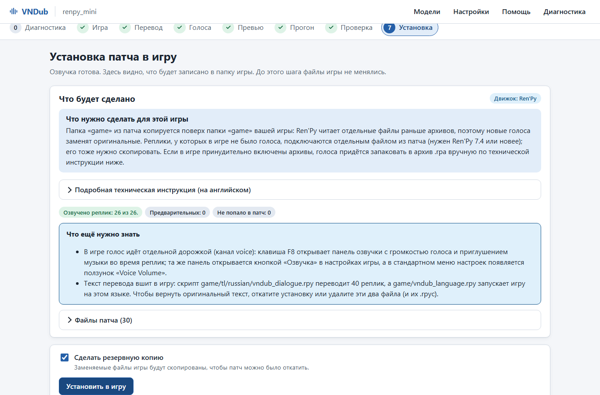

Для некоторых движков (зашифрованный KiriKiri без `version.dll`, игры на Unity) автоматическая установка
невозможна: программа покажет пошаговую инструкцию и никогда не напишет «установлено», если не смогла
установить сама.

**Игры на Ren'Py.** Озвучка идёт отдельной голосовой дорожкой, а не вперемешку с музыкой. В игре клавиша **F8**
открывает панель озвучки: громкость голоса и приглушение музыки и звуков на время реплик. Ту же панель можно открыть
кнопкой **«Озвучка»** в правом верхнем углу экрана настроек игры, а в стандартном меню настроек появляется ползунок
Voice Volume. «Откатить» удаляет и скомпилированный `.rpyc`, который Ren'Py создал рядом со скриптом патча, так что
после отката игра не продолжает выполнять скрипт озвучки. Если голос всё равно не слышно — см. «Частые вопросы».

## Модели

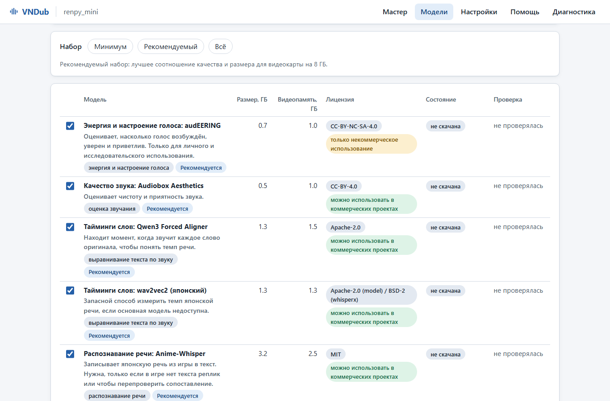

Таблица нейросетей: понятное название и назначение («Голос: Qwen3-TTS 1.7B — основной»,
«Перевод: Gemma 4 12B»), размер, сколько видеопамяти нужно, лицензия. Готовые наборы:

- **«Минимум»** — один голос, перевод и оценка качества;
- **«Рекомендуемый»** — то, что программа использует по умолчанию;
- **«Всё»**.

Модели из набора «Рекомендуемый» помечены значком «Рекомендуется». «Скачать выбранное» берёт файлы прямо с
Hugging Face, показывает прогресс по каждому файлу и умеет докачивать после обрыва (в том числе с того байта,
на котором остановились). «Отменить» срабатывает за секунду-другую, даже когда качается большой файл.
«Проверить» загружает модель, пробует её и записывает, сколько видеопамяти она заняла. Во вкладке «Инструменты»
устанавливаются вспомогательные программы и окружения для моделей. Если сайт недоступен, программа
покажет ссылку и имя файла: скачайте его вручную, положите в указанную папку и нажмите «Установить» ещё раз.

Окружения — это отдельные установки Python с библиотеками нужных версий. Совместимые модели живут в одном
окружении: **основное окружение** объединяет распознавание речи, голоса Qwen3-TTS, определение эмоций и оценку
качества, так что самая тяжёлая библиотека (torch, около 3 ГБ) скачивается один раз, а не трижды. Остальные
окружения (CosyVoice и анализ эмоций FunASR, Chatterbox, RVC, Seed-VC, F5) нужны только потому, что их модели
требуют других версий библиотек. Загрузчик uv хранит кеш рядом с окружениями, поэтому файлы, одинаковые для
нескольких окружений, тоже скачиваются и лежат на диске в одном экземпляре. Начатую установку можно спокойно
оставить и перейти на другой экран: вернувшись, вы увидите тот же прогресс, а по окончании — результат. Если
закрыть программу во время установки, все её процессы завершатся вместе с ней; установку можно начать заново,
уже скачанное не пропадёт.

### Своя модель по ссылке

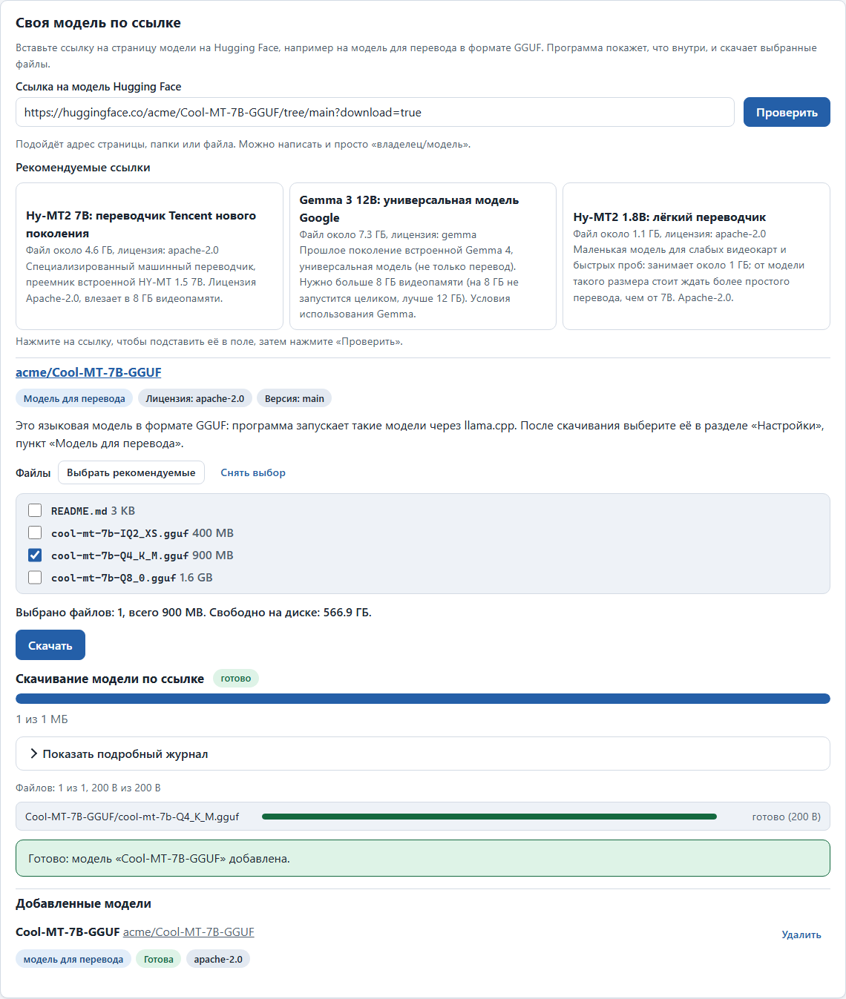

Над таблицей есть карточка «Своя модель по ссылке»: так можно взять любую подходящую модель с Hugging Face,
которой нет в списке, например другую модель для перевода в формате GGUF.

1. Вставьте в поле «Ссылка на модель Hugging Face» адрес страницы модели (подойдёт и адрес папки или файла
   на сайте, и просто «владелец/модель»), нажмите «Проверить». Другие сайты программа не принимает.
   Под полем — «Рекомендуемые ссылки»: нажмите на любую, и она подставится в поле. Список лежит в файле
   `app/recommended_models.json` рядом с программой; его можно править руками.
2. Программа покажет, что нашла: лицензию, список файлов с размерами, сколько места выбрано и сколько свободно.
   Вид модели определяется сам:
   - **«Модель для перевода»** (файлы `.gguf`): программа заранее отмечает один подходящий вариант
     (обычно `Q4_K_M`; файлы из нескольких частей `…-00001-of-00003` берутся все вместе);
   - **«Голосовая модель (RVC)»** (`.pth` и `.index`): скачивается и хранится в списке, но к персонажу
     программа её сама не подключает;
   - **«Просто файлы»**: скачиваются и показываются в списке, в озвучке сами не участвуют;
   - **«Уже есть в списке»**: такая модель уже встроена — программа отметит её в таблице ниже.
3. Нажмите «Скачать». Файлы лягут в `<папка данных>\models\custom\<владелец>__<модель>`, а прогресс будет виден
   по каждому файлу. Остановленную или оборвавшуюся загрузку можно продолжить той же кнопкой.
4. Готовая модель для перевода появится в списке «Добавленные модели». Чтобы по ней переводить, откройте
   «Настройки» и выберите её в пункте «Модель для перевода»; по умолчанию используется Gemma 4 12B. Выбор
   действует со следующего перевода. Кнопка «Удалить» в списке стирает файлы модели.

Если модель закрыта автором (на её странице Hugging Face просят принять условия), скачивание сначала скажет об
этом: откройте страницу модели, примите лицензию и войдите в Hugging Face. Для этого задайте токен в
переменной окружения `HF_TOKEN` или выполните в командной строке `hf auth login`. Проверьте и лицензию:
некоторые запрещают коммерческое использование, а если автор её не указал, программа предупредит.

## Настройки и помощь

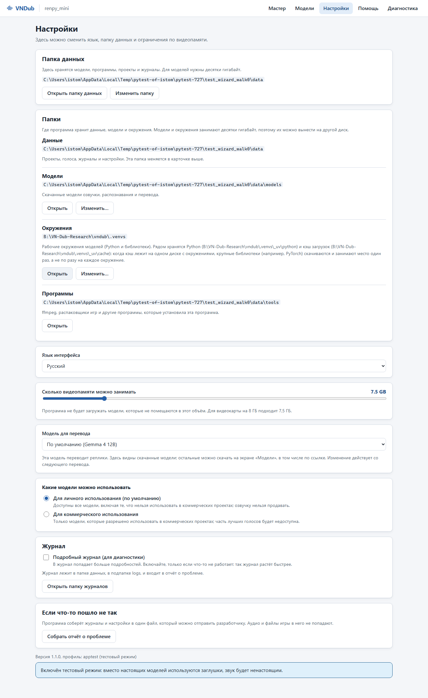

- папка данных;
- **«Папки»** — где что лежит: данные, модели, окружения (вместе с ними Python и кеш загрузчика uv), программы. Модели и
  окружения можно вынести на другой диск («Изменить…»): ничего не переносится автоматически — модели нужно скачать заново
  или перенести самому, окружения установить заново; старая папка остаётся. Пока идёт какая-нибудь задача, папку окружений
  сменить нельзя. «По умолчанию» возвращает папку внутрь папки данных;
- язык интерфейса (русский или английский);
- сколько видеопамяти можно занимать;
- **«Модель для перевода»** — какая из скачанных моделей переводит реплики (по умолчанию Gemma 4 12B;
  сюда попадают и модели, добавленные по ссылке);
- политика лицензий;
- **«Собрать отчёт о проблеме»** — zip с журналами и настройками проекта (без аудио и без файлов игры),
  его можно приложить к вопросу.

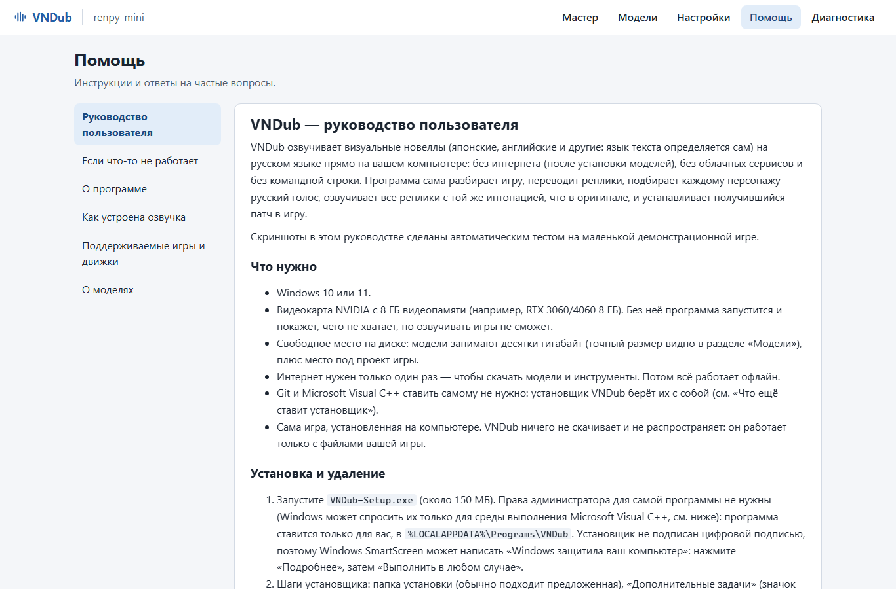

«Помощь» показывает это руководство и советы по неполадкам прямо в программе.

## Частые вопросы

**Программа пишет, что нет подходящей видеокарты.** Для озвучки нужна видеокарта NVIDIA с 8 ГБ памяти.
На компьютере без неё можно посмотреть программу и разобрать игру, но голосовые модели работать не будут.

**Всё очень медленно.** Добавьте папку данных в исключения антивируса (подсказка — на шаге
«Диагностика»), закройте игры и браузер с видео — они занимают видеопамять.

**Можно ли закрыть программу, пока идёт установка или озвучка?** Да. Текущая задача останавливается, все
запущенные ею процессы (загрузчик, модели, сервер перевода) завершаются вместе с программой, в диспетчере задач
ничего не остаётся. При следующем запуске программа предложит продолжить прерванную озвучку; прерванную установку
окружения нужно запустить заново, уже скачанные файлы при этом не скачиваются повторно.

**Можно ли переключаться между экранами во время загрузки?** Да. Загрузка идёт на сервере программы, а не на
экране: вернувшись на экран «Модели» или «Инструменты», вы увидите тот же прогресс, а после окончания — результат.
Отмеченные галочки и выбор видеокарты тоже сохраняются до перезапуска программы.

**Можно ли выключить интернет?** Да, после того как модели и инструменты скачаны. Программа не отправляет
никаких данных и не использует облачные сервисы.

**Игра изменилась после установки, хочу вернуть как было.** Шаг 7 → выберите резервную копию →
«Откатить».

**Голос плохо слышно за музыкой (Ren'Py).** Запустите игру и нажмите **F8** (или откройте настройки игры и нажмите
«Озвучка» в правом верхнем углу): там ползунок голоса и ползунок «Музыка и звуки во время реплик» — чем он левее, тем
сильнее музыка стихает, пока звучит реплика. Выключатель «Приглушать музыку во время реплик» убирает эффект совсем.
Значение по умолчанию (0.3, то есть 30 % громкости музыки во время реплики) можно изменить в `pipeline.yaml` проекта:
`pack.renpy.voice_mix.duck`; после этого соберите патч заново и установите его ещё раз. Клавишу тоже можно сменить
(`pack.renpy.voice_mix.key`, по умолчанию `K_F8`).

**Где мои проекты?** В папке данных, в `projects\<название игры>`. Если открыть ту же папку игры снова,
программа продолжит этот проект.

## Правовая оговорка

VNDub работает с файлами игр, которые принадлежат вам, для личного использования. Клонирование голосов
реальных актёров может быть ограничено законом, лицензионным соглашением игры и лицензиями моделей. Не
распространяйте созданные патчи и голоса без необходимых прав.
